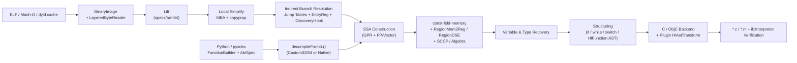

<div align="center">

# xdec

**General-Purpose, Self-Contained, Library-First Multi-Level IL Decompiler & Devirtualization Infrastructure**

[](https://github.com/zhuzhu-Top/xdec/actions/workflows/ci.yml)
[](https://github.com/zhuzhu-Top/xdec/releases)
[](https://github.com/zhuzhu-Top/xdec/releases/latest)
[](https://github.com/zhuzhu-Top/xdec/releases)
[](CMakeLists.txt)

**English** | [简体中文](README.zh-CN.md) | [日本語](README.ja.md) | [한국어](README.ko.md) | [Русский](README.ru.md)

</div>

---

**xdec** lifts AArch64 machine code and custom virtual-machine bytecode into a typed SSA Intermediate Language (IL), simplifies obfuscated control flow (OLLVM / VMP) and Mixed Boolean-Arithmetic (MBA) expressions, emits readable structured C / Objective-C code, and provides `pyxdec` Python bindings with a bit-exact execution verification loop.

> Regression status: **889 Catch2 unit tests passing across Windows, macOS & Linux** · **`pyxdec` pytest passing** · **Self-contained 128-register VM devirtualization sample bit-exact verified**

---

## Core Capabilities

| Capability | Highlights |
|---|---|
| **Library-First Devirtualization (`xdec_devirt` + `pyxdec`)** | Dual-View structured AST (`HlStmt`/`HlExpr` with `il_expr`/`il_op` provenance), generic `summarizeCaseEffects`, architecture-agnostic `AbiSpec` + `FunctionBuilder` + `decompileFromIL()`, `LayeredByteReader` + `RegionMem2Reg`/`RegionDSE`, context-sensitive `devirt::Specializer`, and `DiffVerifier` |
| **Multi-Level IL** | `Lifted` → `Local` → `CFG` → `SSA` → `Resolved` → `Vars` → `Structured` → `Typed`; every maturity level is inspectable and text round-trippable |
| **Full SSA (Scalar, FP & Vector)** | General-purpose, flag, stack-pointer, and `v0..v31`/`d0..d31`/`q0..q31` FP/vector registers integrated into SSA with IEEE-754 comparisons and casts |
| **OLLVM Flattening Recovery** | Detects dispatcher hubs, scatter-dispatcher regions, inline switch case handlers, and emits `while(true) + switch(state)`; supports context-sensitive `(pc, StateKey)` specialization; scales to 67k+ BB flattened functions (~34s end-to-end) |
| **MBA Simplification** | Algebraic rewrite rules and extensible `AlgebraRuleRegistry` (oracle-verified via `il::tryEvalConst` on random + boundary vectors); mega-block guard avoids hangs on 5,000+ instruction blocks |
| **Mach-O / ObjC & Large Binary Exploration** | `--lang objc` (`objc_libcxx` resolves selectors, ivars, protocols, CFStrings), large Mach-O branch-island traversal, `strings`/`xrefs`/`callers`/`callees`/`objc`/`data`, and built-in stdio MCP Server (`serve --mcp`) |
| **Indirect Branch Resolution** | Jump-table detection, bound analysis (complementary `cset`, loop-carried phis), `IDiscoveryHook` (`discoveryFilter`), and iterative multi-round discovery driver |
| **Syscall & Type Recovery** | `svc` → typed `sys_write(...)` calls; shipped C header presets (`android-ndk` / `ios-sdk`) improve signatures and struct field recovery |
| **Plugin System** | Versioned plugin ABI (`XDEC_PLUGIN_ABI_VERSION = 2`) for external IL passes, AST/HL-AST transforms, and oracle-checked rewrite rules while keeping the core sample-agnostic (see [docs/00-core-vs-plugin-prompt.md](docs/00-core-vs-plugin-prompt.md)) |
| **Deterministic Execution & IL Interpreter** | `ExecSession` on-demand native lifting/execution; `il::Interpreter` supports cross-block Phis, multi-function call graphs, and DAG memoization |

---

## Supported Targets

| Dimension | Support |
|---|---|
| **Architectures** | AArch64 (native machine-code lifter) + `Arch::Custom32` / `Arch::Custom64` (mid-pipeline entry for custom virtual ISAs) |
| **Binary Formats** | ELF64 (`.so`, executables), Mach-O (iOS/macOS binaries & dylibs with read-only `mmap`, `__objc_*`, `__unwind_info`), dyld shared cache |
| **Target Profiles** | Android NDK / AArch64 Linux / iOS Mach-O — inferred automatically from the image by `TargetProfile` |
| **EntryReg** | iOS loader-leaked entry registers (`x21`/`x22` dyld base, `x28` kernel residue) resolved via `TargetProfile` formulas + companion images (see [docs/21-entry-reg-platform.md](docs/21-entry-reg-platform.md)) |
| **Obfuscation** | VMP bytecode VMs (register/stack machines, rolling keys), OLLVM control-flow flattening, scatter-dispatchers, MBA, opaque predicates |

---

## Quick Start

### Option 1: Prebuilt Binaries (Recommended — No Build Required)

Download the portable archive for your platform from [GitHub Releases](https://github.com/zhuzhu-Top/xdec/releases) (or grab the latest `master` build from [Actions CI](https://github.com/zhuzhu-Top/xdec/actions/workflows/ci.yml)). Extract and run immediately — each bundle includes `xdec`, bundled plugins (`objc_libcxx`, `ollvm_deobf`), `xdec_helpers.h`, `specs/`, and `types/`:

| Platform | Archive |
|---|---|
| **Windows (x86_64)** | `xdec-<tag>-windows-x86_64.zip` (standalone runtime DLLs bundled, no MSYS2 required) |
| **macOS (Apple Silicon)** | `xdec-<tag>-macos-arm64.tar.gz` |
| **macOS (Intel)** | `xdec-<tag>-macos-x86_64.tar.gz` |
| **Linux (x86_64)** | `xdec-<tag>-linux-x86_64.tar.gz` |

> **Releasing a new version**: Push a `v*` tag (e.g., `git tag v0.2.0 && git push origin v0.2.0`) or manually trigger the `Release` workflow in GitHub Actions to build all four platforms, generate `SHA256SUMS.txt`, and publish the GitHub Release automatically.

### Option 2: Build from Source

#### Requirements

- **CMake** ≥ 3.22, **Ninja**, and a **C++20** compiler (tested with GCC 13/14+, Apple Clang 15/16+)
- **Catch2** — automatically fetched if not installed locally
- **Python 3.12+ & `pybind11`** *(optional — enable `-DXDEC_BUILD_PYTHON=ON` to build `pyxdec`)*

#### Build Commands

```bash
git clone https://github.com/zhuzhu-Top/xdec.git
cd xdec
cmake -B build -G Ninja -DCMAKE_BUILD_TYPE=RelWithDebInfo -DXDEC_BUILD_PYTHON=ON
cmake --build build --parallel
```

Build outputs are placed in `build/bin/`:
- `xdec` / `xdec.exe` — CLI & MCP Server
- `xdec_tests` / `xdec_tests.exe` — Catch2 unit test suite
- `objc_libcxx.{so,dylib,dll}` & `ollvm_deobf.{so,dylib,dll}` — bundled plugins
- `xdec.*.so` / `xdec.*.pyd` — `pyxdec` Python extension module (when `XDEC_BUILD_PYTHON=ON`)
- `xdec_helpers.h` — portable helper header included by generated C output

---

## Usage Examples

### Run the Self-Contained VM Devirtualization Sample

The repository ships a sanitized 128-register custom VM sample in [`samples/rqt/`](samples/rqt/README.md) (no private binaries required):

```bash
PYTHONPATH=build/bin python3 samples/rqt/devirt_rqt.py
```

In under 1 second, it loads the `XIMG` payload, lifts the 333-basic-block `cs` function and its helpers, decompiles them via `xdec.decompile_from_il()` into `samples/rqt/output/`, and runs a bit-exact verification comparing pre-optimization `Cfg` IL against post-optimization `Vars` IL using `xdec.il.Interpreter`.

### Decompile Native Binaries

**Android ELF `.so`**:

```bash
xdec decompile libsdk_bc_lib.so 0x2a2428 -o sub_2a2428.c
```

**iOS Mach-O (C / Objective-C, OLLVM deobfuscation, exploration & MCP Server)**:

```bash
xdec decompile MyApp 0x100023290 --lang objc --allow-unresolved -o out.m
xdec decompile MyApp 0x11475c4c8 --plugin ./ollvm_deobf.dll -o sub_11475c4c8.c
xdec callers MyApp 0x10475b5e4 --depth 1
xdec callees MyApp 0x1017b6c9c
xdec serve MyApp --mcp
```

**dyld shared cache** — open split caches as one unified address space (see [docs/22-dyld-shared-cache.md](docs/22-dyld-shared-cache.md)):

```bash
xdec info dyld_shared_cache_arm64
xdec images dyld_shared_cache_arm64
xdec cache-locate dyld_shared_cache_arm64 0x192464d44
xdec decompile dyld_shared_cache_arm64 0x192464D44 -o sub_192464d44.c --rounds 4 --discovery-cap 36 --allow-unresolved
```

### Common Decompile Options

```text
-o <file.c>                     Write output to file
--lang <c|objc>                 Output dialect (default: c; objc recommended for Mach-O)
--plugin <path>                 Load plugin shared library (repeatable)
--match <glob> --out-dir <dir>  Multi-threaded batch decompile by symbol glob (with -j <N>)
--rounds <n>                    Fixpoint discovery round cap (default: 8)
--allow-unresolved              Seal unresolved indirect branches instead of failing
--discovery-cap <n>             Max new targets admitted per branch per round (0 = unlimited)
--max-span <bytes>              Hard fence dropping discoveries beyond entry+bytes
--types <header|preset>         Import C declarations (android-ndk / ios-sdk / custom header)
--syscall-table <name|none>     Syscall table (default: aarch64-linux)
--tracedb <dir> --trace-id <n>  Guide decompilation by a recorded tracedb execution path
--no-default-plugins            Disable auto-loading objc_libcxx on Mach-O images
```

### Environment Variables

| Variable | Purpose |
|---|---|
| `XDEC_LOG=driver=info,pass=debug` | Per-category diagnostic logging |
| `XDEC_SPEC=<file.xspec>` | Override architecture spec file |
| `XDEC_SAMPLE_<KEY>=<path>` | Local L1 sample binary paths (see [samples/README.md](samples/README.md)) |

---

## Decompilation & Devirtualization Pipeline



---

## C++ Library & Python (`pyxdec`) API

### C++ SDK

```cpp
#include "xdec/api.h"

xdec::pass::Registry registry;
xdec::passes::registerBuiltinPasses(registry);

// Native binary entry
auto res = xdec::decompileToC(engine, reader, entry, registry, opts);

// Or feed custom virtual-ISA IL directly (bypassing the native lifter)
xdec::DecompileFromILOptions ilOpts;
ilOpts.abi = customAbi;
ilOpts.layeredMemory = &layeredMem;
ilOpts.regions = &regions;
auto vmRes = xdec::decompileFromIL(std::move(vmFn), registry, ilOpts);
```

### Python (`pyxdec`)

```python
import xdec

# 1. Open binary and inspect Dual-View (Structured AST + IL + C)
img = xdec.Image.open("target_binary")
res = img.decompile(interp_va, structured_exprs=True)
switches = res.ast.find_all(xdec.ast.StmtKind.Switch)
summary = xdec.analysis.summarize_case_effects(res.il, switches[0].cases[0].il_blocks)

# 2. Lift custom VM ISA -> core optimizer -> bit-exact execution verification
v_fn = builder.finalize(xdec.il.Maturity.Cfg)
out = xdec.decompile_from_il(v_fn, abi=vm_abi, memory=layered, regions=regions)
ret = xdec.il.Interpreter(out.il, memory=layered).call(args=[...], abi=vm_abi)
```

---

## CLI, Exploration & MCP Commands

| Command | Purpose |
|---|---|
| `decompile <binary> <addr\|-s sym>` | Full pipeline → C / Objective-C (supports `--match` batch mode) |
| `serve [binary] --mcp` | Persistent stdio JSON-RPC 2.0 MCP Server (11 reverse-engineering tools) |
| `callers / callees <binary> <addr>` | Call-graph exploration (branch-island traversal & selector propagation) |
| `xrefs / strings / objc / data / functions` | AArch64 ADRP+ADD/LDR xrefs, CStrings, ObjC metadata & section explorer |
| `observe <binary> <addr>` | Run passes step by step and dump each maturity level |
| `lift / disasm / read / memdump / exec` | Low-level lifting, disassembly, memory inspection & block execution |
| `info / sections / symbols / relocs / coverage` | Binary image inspection & ISA spec coverage reports |

Run `xdec help` or `xdec <cmd> --help` for full option lists.

---

## Project Structure

```text
xdec/
├── .github/workflows/  Cross-platform CI & Release workflows (Windows / macOS / Linux)
├── specs/arm64/        ISA specification modules (branch, loadstore, scalar-fp, simd, ...)
├── include/xdec/       Public headers, xdec_helpers.h & api.h
├── src/
│   ├── binary/         ELF / Mach-O (ObjC/CFString metadata) / dyld shared cache, mmap store
│   ├── spec/           Lifting engine (DSL → machine semantics)
│   ├── il/             Multi-level IL, FunctionBuilder, Interpreter (cross-block Phi & call graph)
│   ├── devirt/         LayeredByteReader, MemoryRegionMap, Specializer, RuntimeOracle, DiffVerifier
│   ├── passes/         Optimization & deobfuscation passes (RegionMem2Reg/DSE, AlgebraRuleRegistry)
│   ├── analysis/       CFG, dominators, jump tables, effect_summary, xrefs, EntryReg
│   ├── decompile/      Multi-round discovery driver, decompileToC & decompileFromIL
│   ├── exec/           Deterministic execution, guest memory, external models & trace
│   ├── emit/           Structurizer, HL AST lowerer & C/ObjC backends
│   ├── plugin/         Versioned plugin ABI v2 & dynamic loader
│   └── tools/          xdec CLI, exploration commands & MCP Server
├── bindings/python/    pyxdec (pybind11 Python extension)
├── plugins/            Bundled plugins (objc_libcxx, ollvm_deobf)
├── types/              Type database, syscall tables, android-ndk / ios-sdk presets
├── eval/               L0 regression: ground-truth C corpus
├── samples/            L1 samples & self-contained VM devirtualization demo (samples/rqt/)
├── tests/              889 Catch2 unit tests + Python pytest suite
└── docs/               Design & architecture documentation (00–27)
```

---

## Testing

```bash
# Full C++ unit test suite (889 test cases)
ctest --test-dir build --output-on-failure --parallel 4

# Python pyxdec end-to-end tests
PYTHONPATH=build/bin python3 -m pytest tests/python/test_pyxdec.py -v

# Self-contained 128-register VM devirtualization & bit-exact check
PYTHONPATH=build/bin python3 samples/rqt/devirt_rqt.py
```

---

## Documentation Index

| Document | Topic |
|---|---|
| [00-core-vs-plugin-prompt.md](docs/00-core-vs-plugin-prompt.md) | Core vs. plugin boundaries & design constraints |
| [01-il-spec.md](docs/01-il-spec.md) | IL design: hash-consed expressions, lazy flags, text round-trip |
| [05-deobfuscation.md](docs/05-deobfuscation.md) | MBA algebra, jump tables & discovery loop |
| [06-type-import.md](docs/06-type-import.md) | Header import & type binding |
| [11-helpers-header.md](docs/11-helpers-header.md) | Helper naming & `xdec_helpers.h` |
| [21-entry-reg-platform.md](docs/21-entry-reg-platform.md) | EntryReg platform anchors & companion image discovery |
| [22-dyld-shared-cache.md](docs/22-dyld-shared-cache.md) | Full dyld shared cache support |
| [25-execution.md](docs/25-execution.md) | Standalone execution API, guest memory & basic tracing |
| [26-tracedb-decompile.md](docs/26-tracedb-decompile.md) | Tracedb-guided decompilation |
| [27-devirt-library-architecture.md](docs/27-devirt-library-architecture.md) | Library-First devirtualization architecture (SDK + `pyxdec` + M1–M5) |

---

## License

No `LICENSE` file is currently included in this repository. Please contact the maintainer regarding usage terms.
