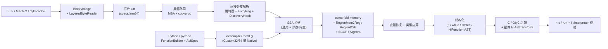

# xdec

**通用、自包含、Library-First 的多级 IL 反编译器与去虚拟化（Devirtualization）基础设施** — 支持将 AArch64 机器码与自定义虚拟机字节码提升为类型化 SSA IL，化简混淆控制流（OLLVM / VMP）与 MBA 表达式，输出可读的结构化 C / Objective-C 代码，并提供 `pyxdec` Python 绑定与 Bit-Exact 执行校验闭环。

当前回归状态：**889 个 Catch2 单元测试（164,554 断言）全部通过** · **`pyxdec` pytest 3/3 通过** · **自包含 128 寄存器 VM 去虚拟化示例 Bit-Exact 通过**

---

## 核心能力

| 能力 | 说明 |
|------|------|
| **Library-First 去 VMP (`xdec_devirt` + `pyxdec`)** | Dual-View 结构化 AST（`HlStmt`/`HlExpr` + `il_expr`/`il_op` 溯源）、通用 `summarizeCaseEffects`、架构无关 `AbiSpec` + `FunctionBuilder` + `decompileFromIL()`、`LayeredByteReader` + `RegionMem2Reg`/`RegionDSE`、`devirt::Specializer` 上下文敏感部分求值、`DiffVerifier` 差分验证 |
| **多级 IL** | Lifted → Local → CFG → SSA → Resolved → Vars → Structured → Typed；每个成熟度层级可独立查看、文本可 round-trip |
| **全量 SSA（含浮点/向量）** | 通用、标志位、栈指针及 `v0..v31`/`d0..d31`/`q0..q31` 浮点/向量寄存器完整接入 SSA，支持 IEEE-754 浮点比较与转型 |
| **OLLVM 扁平化** | 识别 dispatcher hub、scatter-dispatcher 区域、内联 switch case handler、生成 `while(true) + switch(state)`；支持 `Specializer` 按 `(pc, StateKey)` 自动展开 |
| **MBA 化简** | 代数重写规则与可注册 `AlgebraRuleRegistry`（强制经 `il::tryEvalConst` oracle 随机+边界向量验证等价性）；mega-block 安全路径避免 5000+ 指令块 hang |
| **Mach-O / ObjC 与大二进制探索** | 支持 `--lang objc`（`objc_libcxx` 自动解析 selector / ivar / protocol / CFString）、大型 Mach-O 反向跳板（branch island）穿透、`strings`/`xrefs`/`callers`/`callees`/`objc`/`data` 与 stdio MCP Server（`serve --mcp`） |
| **间接分支解析** | 跳转表识别、边界分析（含互补 cset、loop-carried phi）、`IDiscoveryHook`（`discoveryFilter`）、迭代 driver 发现并提升新可达代码 |
| **Syscall & 类型恢复** | `svc` → 带类型的 `sys_write(...)` 命名调用；可选 C 头文件预设（`android-ndk` / `ios-sdk`）改善签名与结构体字段访问 |
| **插件系统** | 统一插件 ABI（`XDEC_PLUGIN_ABI_VERSION = 2`），支持外部 IL pass、AST 变换、HL AST 变换与 oracle 校验规则；核心保持零样本特化（见 [docs/00-core-vs-plugin-prompt.md](docs/00-core-vs-plugin-prompt.md)） |
| **确定性执行与 IL 解释** | `ExecSession` 按需提升并执行原生基本块；`il::Interpreter` 支持跨块 Phi 与多函数调用图解释执行及 DAG 缓存 |

---

## 目标平台

| | 状态 |
|---|---|
| **架构** | AArch64（原生机器码提升） + `Arch::Custom32` / `Arch::Custom64`（自定义虚拟 ISA 中段接入） |
| **二进制格式** | ELF64（`.so`、可执行文件）、Mach-O（iOS/macOS 可执行文件与 dylib，含只读 `mmap`、`__objc_*`、`__unwind_info`）、dyld shared cache |
| **平台配置** | Android NDK / AArch64 Linux / iOS Mach-O — 由 `TargetProfile` 从镜像自动推断，无需手动指定 |
| **EntryReg** | iOS 平台 loader 泄漏的入口寄存器（x21/x22 dyld 基址、x28 内核残留）通过 `TargetProfile` 公式 + companion 镜像解析（见 [docs/21-entry-reg-platform.md](docs/21-entry-reg-platform.md)） |
| **混淆类型** | VMP 字节码虚拟机（寄存器机 / 栈机 / 滚动 key）、OLLVM 控制流平坦化、scatter-dispatcher、MBA、不透明谓词 |

---

## 快速开始

### 环境要求

- **CMake** ≥ 3.22、**Ninja**、**C++20** 编译器（已测试 GCC 14+ / Clang 16+）
- **Catch2** — 本地未安装时自动拉取
- **Python 3.12+ & `pybind11`**（可选，开启 `-DXDEC_BUILD_PYTHON=ON` 编译 `pyxdec` 扩展模块）

### 构建

```powershell
cd xdec
cmake -B build/gcc-release -G Ninja -DCMAKE_BUILD_TYPE=RelWithDebInfo -DXDEC_BUILD_PYTHON=ON
cmake --build build/gcc-release -j 2
```

构建产物位于 `build/gcc-release/bin/`：
- `xdec.exe` — CLI 与 MCP Server
- `xdec_tests.exe` — Catch2 全量单元测试
- `objc_libcxx.dll` / `ollvm_deobf.dll` — 内置插件
- `xdec.*.pyd`（或 `.so`）— `pyxdec` Python 扩展模块
- `xdec_helpers.h` — 反编译输出引用的可移植语义辅助头

### 运行自包含 VM 去虚拟化示例

仓库内置了一个脱敏的 128 寄存器自定义虚拟机实战样本 [`samples/rqt/`](samples/rqt/README.md)（无需任何外部私有二进制）：

```powershell
python samples/rqt/devirt_rqt.py
```

1 秒内完成：加载 `XIMG` 载荷 → 提升 333 个基本块的 `cs` 及其内部 helper → 经 `xdec.decompile_from_il()` 还原 C 源码到 `samples/rqt/output/` → 用 `xdec.il.Interpreter` 对优化前 `Cfg` IL 与优化后 `Vars` IL 执行 Bit-Exact 校验。

### 反编译原生二进制

**Android ELF `.so`**：

```powershell
.\build\gcc-release\bin\xdec.exe decompile libsdk_bc_lib.so 0x2a2428 -o sub_2a2428.c
```

**iOS Mach-O（C / Objective-C 语法与批量导出）**：

```powershell
.\build\gcc-release\bin\xdec.exe decompile MyApp 0x100023290 --lang objc --allow-unresolved -o out.m
.\build\gcc-release\bin\xdec.exe callers MyApp 0x10475b5e4 --depth 1
.\build\gcc-release\bin\xdec.exe callees MyApp 0x1017b6c9c
.\build\gcc-release\bin\xdec.exe serve MyApp --mcp
```

**dyld shared cache** — 多文件 split cache 作为一个统一地址空间打开（见 [docs/22](docs/22-dyld-shared-cache.md)）：

```powershell
.\build\gcc-release\bin\xdec.exe info   dyld_shared_cache_arm64
.\build\gcc-release\bin\xdec.exe images dyld_shared_cache_arm64
.\build\gcc-release\bin\xdec.exe cache-locate dyld_shared_cache_arm64 0x192464d44
.\build\gcc-release\bin\xdec.exe decompile dyld_shared_cache_arm64 0x192464D44 -o sub_192464d44.c --rounds 4 --discovery-cap 36 --allow-unresolved
```

常用反编译选项：

```
-o <file.c>                     输出到文件
--lang <c|objc>                 输出方言（默认 c；Mach-O 推荐 objc）
--match <glob> --out-dir <dir>  按符号通配符多线程批量反编译（配合 -j <N>）
--rounds <n>                    不动点轮次上限（默认 8）
--allow-unresolved              将无法解析的间接分支标记为 opaque，而非失败退出
--discovery-cap <n>             单条分支每轮最多贡献的目标数（0 = 无限制）
--max-span <bytes>              硬性丢弃超出 entry+bytes 的发现（enforce fence）
--types <header|preset>         导入 C 声明（android-ndk / ios-sdk / 自定义头文件）
--syscall-table <name|none>     系统调用编号表（默认 aarch64-linux）
--tracedb <dir> --trace-id <n>  按 tracedb 动态覆盖反编译单次执行路径
--no-default-plugins            禁用 Mach-O 默认自动加载 objc_libcxx 插件
```

环境变量：

| 变量 | 用途 |
|------|------|
| `XDEC_LOG=pass=debug,local=debug` | pass 级诊断日志 |
| `XDEC_SPEC=<file.xspec>` | 覆盖架构 spec |
| `XDEC_SAMPLE_<KEY>=<path>` | L1 样本二进制路径（见 [samples/README.md](samples/README.md)） |

---

## 反编译与去虚拟化流水线



---

## C++ 库与 Python (`pyxdec`) API

### C++ SDK

```cpp
#include "xdec/api.h"

xdec::pass::Registry registry;
xdec::passes::registerBuiltinPasses(registry);

// 原生二进制入口
auto res = xdec::decompileToC(engine, reader, entry, registry, opts);

// 或直接接入自定义虚拟架构 IL（跳过原生 lifter）
xdec::DecompileFromILOptions ilOpts;
ilOpts.abi = customAbi;
ilOpts.layeredMemory = &layeredMem;
ilOpts.regions = &regions;
auto vmRes = xdec::decompileFromIL(std::move(vmFn), registry, ilOpts);
```

### Python (`pyxdec`)

```python
import xdec

# 1. 打开镜像并获取 Dual-View（结构化 AST + IL + C）
img = xdec.Image.open("target_binary")
res = img.decompile(interp_va, structured_exprs=True)
switches = res.ast.find_all(xdec.ast.StmtKind.Switch)
summary = xdec.analysis.summarize_case_effects(res.il, switches[0].cases[0].il_blocks)

# 2. 自定义虚拟架构提升 + 回流核心优化 + Bit-Exact 执行校验
v_fn = builder.finalize(xdec.il.Maturity.Cfg)
out = xdec.decompile_from_il(v_fn, abi=vm_abi, memory=layered, regions=regions)
ret = xdec.il.Interpreter(out.il, memory=layered).call(args=[...], abi=vm_abi)
```

---

## CLI 与探索 / MCP 命令

| 命令 | 用途 |
|------|------|
| `decompile <binary> <addr\|-s sym>` | 完整流水线 → C / Objective-C（支持 `--match` 批量） |
| `serve [binary] --mcp` | 启动 stdio JSON-RPC 2.0 MCP Server（11 个逆向工具） |
| `callers / callees <binary> <addr>` | 函数级调用图分析（支持跨 branch island 反向穿透与 selector 传播） |
| `xrefs / strings / objc / data / functions` | AArch64 ADRP+ADD/LDR 交叉引用、CString、ObjC 类/方法与段数据浏览器 |
| `observe <binary> <addr>` | 逐步运行 pass，dump 每个成熟度层级 |
| `lift / disasm / read / memdump / exec` | 底层提升、反汇编、内存读取与块级执行 |
| `info / sections / symbols / relocs / coverage` | 二进制镜像信息与 spec 覆盖率检查 |

运行 `xdec help` 或 `xdec <cmd> --help` 查看完整参数。

---

## 项目结构

```
xdec/
├── specs/arm64/        架构 spec 模块（branch、loadstore、scalar-fp、simd 等 .xspec）
├── include/xdec/       公共头文件 + xdec_helpers.h + api.h
├── src/
│   ├── binary/         ELF / Mach-O（含 ObjC/CFString 元数据）/ dyld cache、mmap 后端
│   ├── spec/           提升引擎（DSL → 机器语义）
│   ├── il/             多级 IL、FunctionBuilder、Interpreter（支持跨块 Phi 与多函数）
│   ├── devirt/         LayeredByteReader、MemoryRegionMap、Specializer、RuntimeOracle、DiffVerifier
│   ├── passes/         优化与去混淆 pass（含 RegionMem2Reg/RegionDSE、AlgebraRuleRegistry）
│   ├── analysis/       CFG、支配树、跳转表、effect_summary、xrefs、EntryReg 等
│   ├── decompile/      多轮发现 driver + decompileToC + decompileFromIL
│   ├── exec/           确定性执行、guest 内存、外部边界与 trace
│   ├── emit/           结构化器 + HL AST lowerer + C/ObjC 后端
│   ├── plugin/         统一插件 ABI v2 与动态加载器
│   └── tools/          xdec CLI + explore 命令 + MCP Server
├── bindings/python/    pyxdec（pybind11 Python 扩展）
├── plugins/            内置插件（objc_libcxx、ollvm_deobf）
├── types/              类型数据库、syscall 表、android-ndk / ios-sdk 预设
├── eval/               L0 回归：ground-truth C 语料
├── samples/            L1 样本与自包含 VM 去虚拟化演示（samples/rqt/）
├── tests/              889 个 Catch2 单元测试 + Python pytest 套件
└── docs/               设计文档（00–27）
```

---

## 测试

```powershell
# C++ 全量单元测试（889 test cases）
.\build\gcc-release\bin\xdec_tests.exe

# Python pyxdec 端到端测试
python -m pytest -p no:xonsh tests/python/test_pyxdec.py -v

# 自包含 128 寄存器 VM 去虚拟化演示与 Bit-Exact 校验
python samples/rqt/devirt_rqt.py
```

---

## 文档索引

| 文档 | 主题 |
|------|------|
| [00-core-vs-plugin-prompt.md](docs/00-core-vs-plugin-prompt.md) | 核心 vs 插件边界、开发约束 |
| [01-il-spec.md](docs/01-il-spec.md) | IL 设计：hash-cons 表达式、惰性标志位、文本 round-trip |
| [05-deobfuscation.md](docs/05-deobfuscation.md) | MBA 代数、跳转表、发现循环 |
| [06-type-import.md](docs/06-type-import.md) | 头文件导入与类型绑定 |
| [11-helpers-header.md](docs/11-helpers-header.md) | Helper 命名与 `xdec_helpers.h` |
| [21-entry-reg-platform.md](docs/21-entry-reg-platform.md) | EntryReg 平台锚点：`TargetProfile` 公式 + companion 镜像自动发现 |
| [22-dyld-shared-cache.md](docs/22-dyld-shared-cache.md) | dyld shared cache 完整支持 |
| [25-execution.md](docs/25-execution.md) | 独立执行 API、guest 内存所有权、外部模型边界与基础 trace |
| [26-tracedb-decompile.md](docs/26-tracedb-decompile.md) | Tracedb 引导反编译 |
| [27-devirt-library-architecture.md](docs/27-devirt-library-architecture.md) | Library-First 反 VMP 架构方案（SDK + `pyxdec` + M1–M5 路线图） |

---

## 许可证

仓库尚未包含 License 文件。使用条款请联系仓库维护者。
